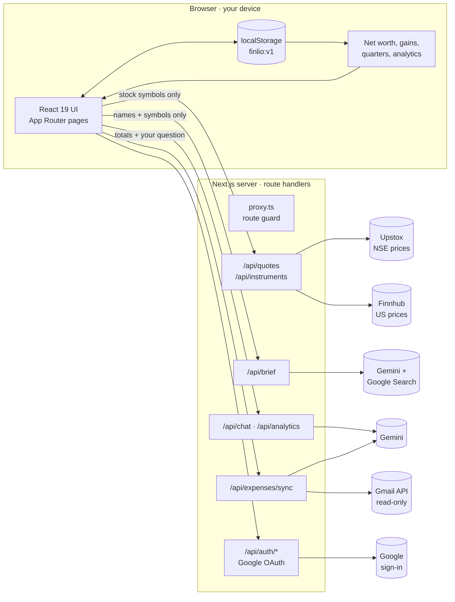
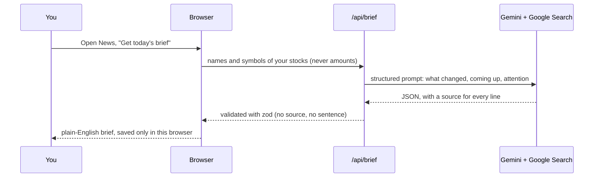

<div align="center">


# Finlio

**Know why your money moved, in plain English.**

A private, AI-assisted money dashboard for India 🇮🇳 and the United States 🇺🇸.
It reads the news about what you own, adds up everything you have, and explains it in plain words.

[](https://nextjs.org)
[](https://react.dev)
[](https://www.typescriptlang.org)
[](https://ai.google.dev)
[](LICENSE)

[Demo video](#demo) · [Features](#features) · [Architecture](#system-architecture) · [Getting started](#getting-started) · [Devpost](#devpost-build-with-ai-basics)

</div>

---

## The problem

Your stocks sit in one app. Your savings sit in another. The news is somewhere else.

When your money moves, nobody tells you why. Most people, and most students in India, were never taught where to look, so they guess or give up.

## The idea

Finlio reads **only the news about what you own**, then tells you what changed, what's coming up, and what deserves your attention, in short sentences with a link to every source. Around that brief it holds the whole picture of your money: stocks, savings, gold, property, loans and spending.

> **Finlio explains. It never advises.** It never says buy, sell or hold.

## Demo

A 39-second launch film is in the Devpost submission. The video uses a sample household; the figures are examples.

To record your own walkthrough, open any page with `?demo=1` (see [Demo mode](#demo-mode)).

## Features

| Area | What you get |
|---|---|
| **Dashboard** | Net worth with quarterly bars (Indian financial year or calendar quarters), this month in, out and saved, recent activity, quick add |
| **News** | Today's brief for the stocks you own: *Deserves your attention*, *What changed*, *Coming up*. Filter by stock; every line links to its source |
| **Holdings** | Each stock's price, today's move, value and gain; open one for a detail card with *why it moved* |
| **Expenses** | Optional, read-only Gmail connection turns bank and UPI alerts into categorised spending; manual income and expenses too |
| **Assets & loans** | Savings, FDs, EPF/PPF, gold, property, 401(k)/IRA, and every kind of loan |
| **Analytics** | Where your money sits, spending by category, and a money-flow chart from income to spending |
| **Finlio chat** (⌘L) | Ask about your own money in plain English. It sees totals and percentages, never transactions or quantities |
| **India and US** | Currency, stock market, financial year and account types follow your country |
| **Private by design** | Sign in with Google; your money data stays in your browser. No Finlio database |

## System architecture

Finlio is one Next.js 16 app with two halves: the **browser**, which holds all of your financial data, and a thin **server**, which holds the secret keys and talks to outside services on your behalf. There is no database.



### How a morning brief is made



### Design principles

| Principle | How it shows up |
|---|---|
| **Your data stays on your device** | Holdings, assets, entries, briefs and history live in `localStorage`. Backups are a JSON file you download. Sign-out erases them |
| **Send the minimum** | Prices get stock symbols. The brief gets names and symbols. Chat gets totals and percentages. Quantities, buy prices and balances never leave the browser |
| **Every claim has a source** | The brief schema rejects any line without a source. A stock with no news says so; Finlio never invents a reason |
| **Explain, never advise** | Prompts and copy forbid buy, sell or hold suggestions |
| **Secrets stay on the server** | API keys live only in server route handlers. Google tokens sit in an encrypted (AES-256-GCM), httpOnly cookie |
| **Least privilege with Google** | Sign-in asks for name, email and photo. Read-only Gmail is a separate, optional grant on Expenses, and can be revoked on its own |

### Security model

- **Sign-in:** a hand-written Google OAuth flow with a `state` check, the `next` path limited to the same site, and the session in an encrypted httpOnly cookie (`finlio_google`, up to 30 days).
- **Routing:** `proxy.ts` sends signed-out visitors from app pages to `/sign-in`. The app re-checks the cookie and clears a broken one without a redirect loop.
- **Scopes:** `openid email profile` to sign in; `gmail.readonly` only when you connect Expenses. *Disconnect Gmail* revokes Gmail but keeps you signed in; *Sign out* revokes everything.
- **No keys in the browser:** `GEMINI_API_KEY`, `UPSTOX_ANALYTICS_TOKEN`, `FINNHUB_API_KEY` and the Google client secret are used only in route handlers marked `server-only`.

## Tech stack

| Layer | Choice |
|---|---|
| Framework | [Next.js 16](https://nextjs.org) (App Router, Turbopack, cache components), [React 19](https://react.dev), TypeScript |
| UI | [Tailwind CSS v4](https://tailwindcss.com), [shadcn/ui](https://ui.shadcn.com) on Base UI, [beUI](https://beui.dev) charts and chat kit, [lucide](https://lucide.dev) icons, [Geist](https://vercel.com/font) |
| Motion and sound | [GSAP](https://gsap.com), [Motion](https://motion.dev), [cuelume](https://www.npmjs.com/package/cuelume) interface sounds (with an off switch) |
| AI | [Google Gemini](https://ai.google.dev) via `@google/genai`, with Google Search grounding for the brief |
| Data | [Upstox](https://upstox.com/developer/api-documentation/) (NSE prices), [Finnhub](https://finnhub.io) (US prices), [Gmail API](https://developers.google.com/gmail/api) (read-only alerts) |
| Validation | [zod](https://zod.dev) on request bodies and on Gemini's output |
| Built with | [Claude Code](https://claude.com/claude-code) and the [Devpost Learn Skill Pack](https://github.com/challengepost/learn-ai-basics) |

## Project structure

```
finlio/
├── app/
│   ├── (marketing)/          # landing page, sign-in, sign-up, setup, cookies
│   ├── (app)/                # the signed-in app: dashboard, news, holdings,
│   │                         # expenses, assets, analytics, terms
│   ├── api/                  # route handlers: auth, quotes, instruments,
│   │                         # brief, chat, analytics, expenses/sync, logo
│   ├── layout.tsx            # fonts, theme, providers
│   └── globals.css           # Tailwind v4 tokens, light and dark
├── components/               # UI: shell, chat, brief, settings, landing, auth
├── lib/
│   ├── store.tsx             # localStorage store (the only "database")
│   ├── networth.ts           # net worth, allocation, monthly totals
│   ├── portfolio.ts          # positions, gains, day change
│   ├── gemini.ts             # server-only Gemini client and prompts
│   ├── brief-schema.ts       # zod schema: no source, no sentence
│   ├── google-session.ts     # OAuth, encrypted session cookie
│   ├── upstox.ts · finnhub.ts# market data (server-only)
│   ├── locale.ts             # India / US: currency, market, quarters
│   └── demo-mode.ts · demo-data.ts
├── proxy.ts                  # route guard for app pages
├── devpost/                  # scope, PRD, spec, build checklist
├── LICENSE                   # MIT
└── THIRD_PARTY_NOTICES.md
```

## Getting started

**Requirements:** Node.js 20 or newer, and [pnpm](https://pnpm.io).

```bash
git clone https://github.com/Gokulakrishnxn/finlio.git
cd finlio
pnpm install
cp .env.example .env.local   # fill in the keys you have
pnpm dev
```

Open **http://localhost:3000** for the landing page. Choose **Get started**, sign in with Google, then pick your country and start with sample data or an empty dashboard.

**No keys at all?** Finlio still runs. Without Google keys the sign-in page offers **Open Finlio on this device**, and each feature that needs a key says so where it's used.

### Environment variables

Kept in `.env.local`, which is git-ignored. Never commit real keys.

| Variable | Used for | Where to get it |
|---|---|---|
| `GEMINI_API_KEY` | Brief, chat, analytics, reading alerts | [Google AI Studio](https://aistudio.google.com/apikey). **Google Search grounding needs billing enabled** on the key's project |
| `GOOGLE_CLIENT_ID`, `GOOGLE_CLIENT_SECRET` | Sign-in, and Gmail for Expenses | [Google Cloud console](https://console.cloud.google.com): enable the Gmail API, OAuth consent screen *External / Testing* with your account as a test user, a *Web application* client with redirect URI `http://localhost:3000/api/auth/callback/google` |
| `AUTH_SECRET` | Encrypting the session cookie | Any long random string, e.g. `openssl rand -base64 32` |
| `UPSTOX_ANALYTICS_TOKEN` | Live NSE prices | [Upstox developer console](https://upstox.com/developer/api-documentation/), analytics token (read-only) |
| `FINNHUB_API_KEY` | US stock search and prices | [finnhub.io](https://finnhub.io), free plan. Without it, US stocks come from a built-in list and are valued at cost |
| `GEMINI_MODEL` *(optional)* | Choosing the Gemini model | Defaults to `gemini-3.5-flash` |

> Gmail read access is a restricted Google scope. Until Google verifies the app, only the test users you add can connect Gmail, and Google shows an "unverified app" notice.

### Scripts

| Command | What it does |
|---|---|
| `pnpm dev` | Development server on port 3000 |
| `pnpm build` | Production build |
| `pnpm start` | Serve the production build |
| `pnpm lint` | ESLint |

### Demo mode

For screen recordings, open any page with `?demo=1`. Finlio then:

- skips Google sign-in
- hides set-up notices, sample labels and the dev badge
- turns company logos off (they're other companies' trademarks)
- gives the **sample** stocks steady demo prices and a brief built from them
- answers the chat's six suggested questions instantly from your own numbers

Nothing on screen says "demo". `?demo=0` turns it off. Your own stocks always show real prices or none.

## Devpost: Build With AI: Basics

Finlio was built for [Build With AI: Basics](https://learn-ai-basics.devpost.com).

| Requirement | Where to find it |
|---|---|
| Built with the Devpost Learn Skill Pack | Installed in [`.agents/skills/`](.agents/skills) (linked from `.claude/skills/`), pinned in [`skills-lock.json`](skills-lock.json): `1-start` → `2-scope` → `3-prd` → `4-spec` → `5-build` → `6-ship`, committed in *"Add Devpost Learn Skill Pack (challengepost/learn-ai-basics)"* |
| Scope | [`devpost/scope.md`](devpost/scope.md): the idea, who it's for, what "done" means (approved) |
| Product requirements | [`devpost/prd.md`](devpost/prd.md): every screen and behaviour (approved) |
| Technical spec | [`devpost/spec.md`](devpost/spec.md): architecture and technical plan (approved) |
| Build log | [`devpost/checklist.md`](devpost/checklist.md): ordered build steps, what was verified, and every change along the way |
| Open source licence | [MIT](LICENSE) |
| Third-party code | Credited in [`THIRD_PARTY_NOTICES.md`](THIRD_PARTY_NOTICES.md) |

### How it was built

Planning came first. Each skill wrote one document, and each was approved before the next began: scope, then the PRD, then the spec. The build then followed the checklist one step at a time, each step verified in the browser and committed on its own. The commit history shows that order.

### Prior work

The [finlio.app](https://www.finlio.app) waitlist page existed before this hackathon. This project reuses its **name, logo mark, colour palette, the app logos on the landing page, and the "same news, two ways" idea**. All application code in this repository was written during the submission period.

## Roadmap

- Mutual funds alongside stocks
- The morning brief by email
- Goals: what to put aside for the things you want
- Price alerts

## Acknowledgements

Built with [Claude Code](https://claude.com/claude-code). UI components from [beUI](https://beui.dev) and [shadcn/ui](https://ui.shadcn.com), credited in [`THIRD_PARTY_NOTICES.md`](THIRD_PARTY_NOTICES.md). Company names and logos belong to their owners.

## License

[MIT](LICENSE) © 2026 Gokulakrishnan · [gokulakrishnan.dev](https://www.gokulakrishnan.dev)
