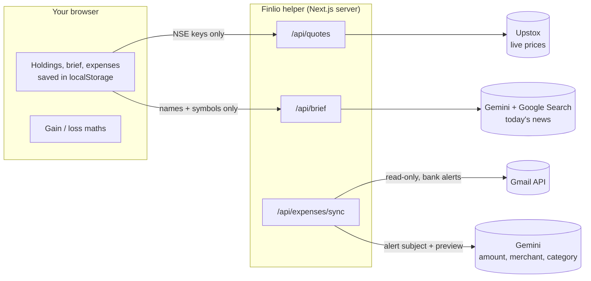

# Finlio

**Your money should be easier to understand.**

Finlio Daily turns your financial snapshot into a clear briefing: what changed, what's coming up, and what deserves your attention.

**For India 🇮🇳 and the United States 🇺🇸.** · [finlio.app](https://www.finlio.app) · Built for [Build With AI: Basics](https://learn-ai-basics.devpost.com) on Devpost

---

## The problem

Your stocks sit in one app. Your mutual funds sit in another. The news is somewhere else.
When your money moves, nobody tells you why, so you spend hours connecting the dots yourself.

## What Finlio does

| Screen | What you get |
|---|---|
| **Today** | A greeting, **today's brief** for the stocks you own, your portfolio's worth, today's change and gain since you bought |
| **Holdings** | Every NSE stock you own with live price, today's move, value and gain; open one to see *why it moved* and the headlines behind it |
| **Expenses** | Sign in with Google and Finlio reads your bank and UPI alert emails (read-only) to show what you spent this month, by category |
| **News** | Today's brief: why the stocks you own moved, in plain words, with sources |
| **Settings → Privacy** | Exactly what is stored and what is sent, and **Sign out** (erases Finlio from this browser) |

Today's brief has three parts:

- **What changed** — which of your holdings moved, and why, in plain words
- **Coming up** — results, dividends and meetings mentioned in the news
- **Deserves your attention** — at most two things worth a closer look

Every sentence links to the headline it came from. A stock with no news says so; Finlio never invents a reason.
**Finlio explains. It doesn't advise** — it never says buy, sell or hold.

## How it works



- **No Finlio account and no database.** Holdings, briefs and expenses live in your browser.
- **Only stock names and symbols leave your device** for prices and news. Quantities, buy prices and portfolio value never do; gains are worked out in the browser.
- **Expenses** uses Google sign-in with the read-only Gmail scope. The Google token is kept in an encrypted, httpOnly cookie in your browser. Only bank and UPI alert emails are read, and only their sender, subject and preview go to Gemini. **Disconnect** revokes access.

The full design lives in [`devpost/spec.md`](devpost/spec.md).

## Getting started

**Requirements:** Node.js 20+ and pnpm.

```bash
git clone https://github.com/Gokulakrishnxn/finlio.git
cd finlio
pnpm install
cp .env.example .env.local   # then fill in the keys below
pnpm dev
```

Open **http://localhost:3000** for the landing page, or **/dashboard** for the app. Every screen works without keys in a reduced way, and each feature that needs a key says so where it's used (for example *Try a sample portfolio* and stock search need no keys).

### Keys (in `.env.local`, never committed)

| Variable | Used for | Where to get it |
|---|---|---|
| `GEMINI_API_KEY` | Today's brief, reading expense alerts | [Google AI Studio](https://aistudio.google.com/apikey). Google Search grounding needs **billing enabled** on the key's project (the first 5,000 searches a month are free). |
| `FINNHUB_API_KEY` | US stock search and live prices | [finnhub.io](https://finnhub.io) free plan. Without it, US stocks can be found in a built-in list of popular stocks and are valued at cost. |
| `UPSTOX_ANALYTICS_TOKEN` | Live NSE prices | [Upstox developer console](https://upstox.com/developer/api-documentation/) → analytics token (read-only market data; needs an Upstox account) |
| `GOOGLE_CLIENT_ID`, `GOOGLE_CLIENT_SECRET` | Expenses (Google sign-in) | [Google Cloud console](https://console.cloud.google.com): enable the **Gmail API**, set the OAuth consent screen to **External / Testing** with your Gmail as a test user, create a **Web application** OAuth client with redirect URI `http://localhost:3000/api/auth/callback/google` |
| `AUTH_SECRET` | Encrypting the Google session cookie | Any long random string, e.g. `openssl rand -base64 32` |
| `GEMINI_MODEL` (optional) | Choosing the Gemini model | Defaults to `gemini-3.5-flash` |

> Gmail read access is a restricted Google scope. Until Google verifies the app, Expenses works only for the test users you add, and Google shows an "unverified app" notice during sign-in.

### Trying it

On first visit Finlio asks for your name and country (India or United States), asks you to accept the [Terms](app/(app)/terms/page.tsx), and offers sample data and a short tour. Your country sets the currency (₹ or $), the stock market (NSE or NYSE/Nasdaq), quarters (Apr–Mar financial year or calendar year) and account types (EPF/PPF or 401(k)/IRA). Change it any time in Settings → Profile.


1. On **Today**, press **Try a sample portfolio** (real NSE stocks, example buy details, labelled *Sample*) or **Add your first stock**.
2. Press **Get today's brief**, then open any source chip to see the headline behind a sentence.
3. Open a holding to see its position and *why it moved*.
4. On **Expenses**, press **Continue with Google**, then **Sync**.
5. **Sign out** (profile menu or Settings) disconnects Google and erases Finlio from this browser, back to the welcome screen; download a backup first to restore later.

## Built with

[Next.js 16](https://nextjs.org) · [Tailwind CSS v4](https://tailwindcss.com) · [shadcn/ui](https://ui.shadcn.com) · [GSAP](https://gsap.com) · [lucide](https://lucide.dev) · [Geist](https://vercel.com/font) · [zod](https://zod.dev) · [@google/genai](https://ai.google.dev) · [Upstox API](https://upstox.com/developer/api-documentation/) · [Gmail API](https://developers.google.com/gmail/api)

## Project documents

Planned with the [Devpost Learn Skill Pack](https://github.com/challengepost/learn-ai-basics):

- [`devpost/scope.md`](devpost/scope.md) — the core idea and the definition of done
- [`devpost/prd.md`](devpost/prd.md) — screens, behaviour, and the now/later boundary
- [`devpost/spec.md`](devpost/spec.md) — architecture and technical plan
- [`devpost/checklist.md`](devpost/checklist.md) — build steps, verification and revisions

## Prior work

The [finlio.app](https://www.finlio.app) waitlist page existed before this hackathon. This project reuses its **name, logo mark, colour palette and the "same news, two ways" idea**. All application code in this repository was written during the submission period.

## License

[MIT](LICENSE) © 2026 Gokulakrishnan · [gokulakrishnan.dev](https://www.gokulakrishnan.dev)
