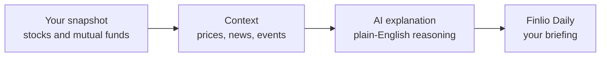

# Finlio

**Your money should be easier to understand.**

Finlio Daily turns your financial snapshot into a clear briefing: what changed, what's coming up, and what deserves your attention.

[finlio.app](https://www.finlio.app) · Built for [Build With AI: Basics](https://learn-ai-basics.devpost.com) on Devpost

> **Status:** in active development. Submission window: September 22 – October 26, 2026.

---

## The problem

Your stocks sit in one app. Your mutual funds sit in another. The news is somewhere else.
When your money moves, nobody tells you why, so you spend hours connecting the dots yourself.

## Finlio Daily

One short briefing, in plain words, built only from what you own.

| Section | What it answers |
|---|---|
| **What changed** | Which of your holdings moved, and why |
| **What's coming up** | Upcoming events that may affect what you own |
| **What deserves your attention** | The one or two things worth a closer look |

Finlio explains. It does not tell you what to buy or sell.

## How it works

The full technical design lives in [`devpost/spec.md`](devpost/spec.md).

## Project documents

Planned with the [Devpost Learn Skill Pack](https://github.com/challengepost/learn-ai-basics):

- [`devpost/scope.md`](devpost/scope.md): the core idea and the definition of done
- [`devpost/prd.md`](devpost/prd.md): screens, behaviour, and the now/later boundary
- [`devpost/spec.md`](devpost/spec.md): architecture and technical plan

## Getting started

Setup instructions will be added as the build lands.

## Prior work

The [finlio.app](https://www.finlio.app) waitlist page existed before this hackathon. All application code in this repository was written during the submission period.

## License

[MIT](LICENSE) © 2026 Gokulakrishnan · [gokulakrishnan.dev](https://www.gokulakrishnan.dev)
